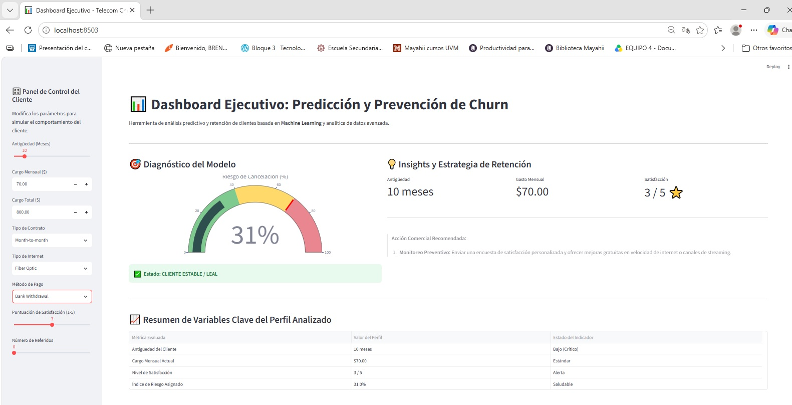
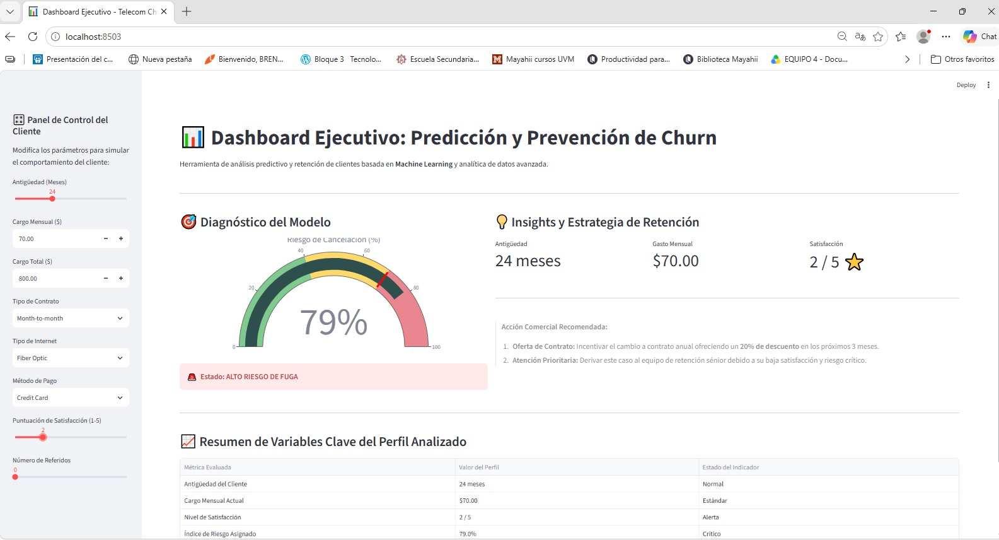

# 📊 Telecom Churn Prediction & Retention Dashboard

[](https://www.python.org/)
[](https://streamlit.io/)
[](https://scikit-learn.org/)
[](https://opensource.org/licenses/MIT)

> **Aplicación End-to-End de Machine Learning** enfocada en la predicción y prevención proactiva de la cancelación de clientes (*Churn*) en empresas de telecomunicaciones. Alcanza un **95.24% de precisión (Accuracy)** y ofrece un **Dashboard Ejecutivo interactivo con recomendaciones de negocio automatizadas**.

## 🖥️ Vista Previa del Dashboard Ejecutivo

### 🟢 Cliente Estable (Bajo Riesgo de Churn)


### 🔴 Cliente en Alto Riesgo de Fuga (Alerta Crítica)



---

## 🎯 Problema de Negocio

En la industria de las telecomunicaciones, el costo de adquisición de un nuevo cliente es significativamente más alto que el costo de retener a uno existente. La pérdida de clientes (*Customer Churn*) impacta directamente los ingresos recurrentes (MRR) y el valor de vida del cliente (CLTV).

**Objetivo:** Desarrollar una solución integral que permita a los equipos comerciales y de fidelización:
1. Identificar en tiempo real qué clientes presentan un alto riesgo de cancelar su suscripción.
2. Comprender los factores críticos que motivan la cancelación.
3. Recibir recomendaciones estratégicas automatizadas para ejecutar campañas de retención oportunas.

---

## 🚀 Características Clave

- **Modelo Predictivo de Alto Rendimiento:** Algoritmo *Random Forest Classifier* entrenado con un dataset extendido de IBM (7,043 registros y 45 variables de comportamiento, facturación y demografía).
- **Dashboard Ejecutivo Interactivo:** Desarrollado con **Streamlit** y **Plotly** para simulación en tiempo real y visualización de riesgo mediante indicadores tipo tacómetro (*Gauge Chart*).
- **Lógica de Negocio y Recomendaciones:** Clasificación automatizada en niveles de riesgo (*Bajo, Moderado, Crítico*) con acciones comerciales sugeridas para fidelización.
- **Arquitectura Modular & Git Flow:** Código limpio, mantenible y estructurado siguiendo mejores prácticas de ingeniería de software con control de versiones en ramas (`main`, `quality`, `developer`).

---

## 🛠️ Tecnologías y Herramientas (Tech Stack)

- **Lenguaje:** Python 3.10+
- **Análisis y Manipulación de Datos:** Pandas, NumPy
- **Machine Learning & Preprocesamiento:** Scikit-Learn (`RandomForestClassifier`, `LabelEncoder`, `train_test_split`), Joblib
- **Visualización e Interfaz Web:** Streamlit, Plotly
- **Control de Versiones & Entorno:** Git, GitHub, Virtualenv

---

## 📁 Estructura del Proyecto

```text
Telco Customer Churn/
│
├── data/
│   └── WA_Fn-UseC_-Telco-Customer-Churn.csv  # Dataset extendido de IBM
│
├── src/
│   ├── preprocessing.py                      # Limpieza y preparación de datos
│   ├── train_model.py                        # Entrenamiento y evaluación del modelo
│   ├── modelo_churn.pkl                      # Modelo entrenado exportado
│   └── columnas_modelo.pkl                   # Estructura de características
│
├── .gitignore                                # Filtro de archivos no rastreados
├── app.py                                    # Aplicación interactiva con Streamlit
├── requirements.txt                          # Dependencias del proyecto
└── README.md                                 # Documentación del proyecto

---

## 📊 Resultados y Evaluación del Modelo

El modelo de Random Forest superó el desempeño esperado al evaluarse en el conjunto de prueba (20% de los datos):

Métrica                            Resultado
Accuracy (Precisión Global)          95.24%
Dataset Evaluado                     7,043 clientes
Variables Analizadas                    45 (Demografía, Servicios, Facturación, Satisfacción)

Factores Críticos Identificados:

- Tipo de Contrato: Los contratos mes a mes (Month-to-month) presentan la tasa de fuga más alta.
- Puntuación de Satisfacción: Evaluaciones inferiores a 3/5 se correlacionan directamente con el abandono del servicio.
- Antigüedad del Cliente (Tenure): Los primeros 12 meses representan la ventana crítica de mayor riesgo.

---

## 💻 Instalación y Ejecución Local

Sigue estos pasos para clonar y ejecutar la aplicación en tu entorno local:

Clonar el repositorio:

Bash
git clone [https://github.com/BrendaAlicia15/telecom-churn-app.git](https://github.com/BrendaAlicia15/telecom-churn-app.git)
cd telecom-churn-app

Crear y activar un entorno virtual:
Bash
# Windows
python -m venv venv
venv\Scripts\activate

# macOS / Linux
python3 -m venv venv
source venv/bin/activate

Instalar dependencias:
Bash
pip install -r requirements.txt

Entrenar el modelo (Opcional):
Bash
python src/train_model.py

Iniciar la aplicación Streamlit:
Bash
streamlit run app.py

---

##👩‍💻 Autora

Brenda Alicia

GitHub: @BrendaAlicia15
LinkedIn: https://www.linkedin.com/in/brenda-alicia-barreras-yepiz-7a5a463/
Proyecto: Telecom Churn Prediction App

Si este proyecto te resultó útil o interesante, ¡no dudes en darle una ⭐ en GitHub!
# telecom-churn-app
Aplicación End-to-End de Machine Learning (Random Forest) para predecir la cancelación de clientes (Churn) en telecomunicaciones con un 95% de precisión, desplegada con una interfaz interactiva en Streamlit.
